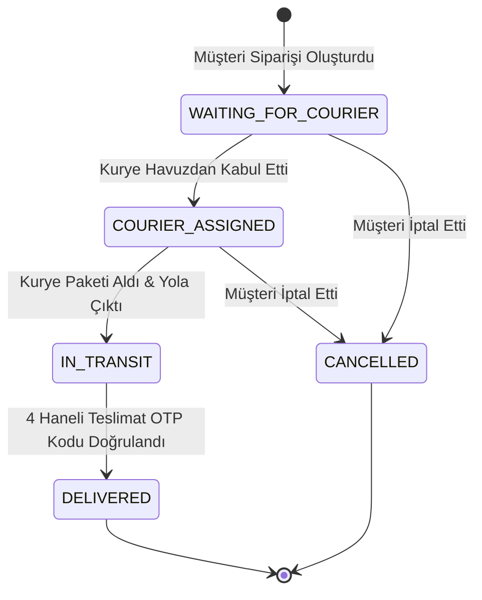

# 📦 RouteDuck - Şehir İçi Mikro Lojistik
## 📋 Şu Ana Kadar Yapılanlar Raporu (`şuana kadar yapılanlar.md`)

Bu doküman, **Şehir İçi Mikro Lojistik (RouteDuck)** mobil ve web uygulamasında bugüne kadar tamamlanan tüm mimari kararları, iş mantıklarını, arayüz bileşenlerini, veritabanı kurgusunu ve yapılan son kritik iyileştirmeleri kapsamlı olarak özetlemektedir.

---

## 📑 İçindekiler
1. [Proje Vizyonu ve Temel Mimari](#1-proje-vizyonu-ve-temel-mimari)
2. [Yerel Veritabanı ve Oturum Yönetimi (Hive DB)](#2-yerel-veritabanı-ve-oturum-yönetimi-hive-db)
3. [Lojistik Motoru ve Akıllı Eşleştirme Kuralları](#3-lojistik-motoru-ve-akıllı-eşleştirme-kuralları)
4. [Kullanıcı Arayüzü (UI / UX) ve Ekranlar](#4-kullanıcı-arayüzü-ui--ux-ve-ekranlar)
5. [Tasarım Sistemi, Logo ve Özel Çizimler](#5-tasarım-sistemi-logo-ve-özel-çizimler)
6. [Son Yapılan Kritik Düzeltmeler ve İyileştirmeler](#6-son-yapılan-kritik-düzeltmeler-ve-iyileştirmeler)
7. [Testler ve Kod Sağlığı](#7-testler-ve-kod-sağlığı)
8. [Geliştirilen Dosya ve Dizin Listesi](#8-geliştirilen-dosya-ve-dizin-listesi)

---

## 1. Proje Vizyonu ve Temel Mimari

- **İki Taraflı Pazar Yeri (Two-Sided Marketplace):** Aynı uygulama üzerinde hem **Müşteri (Customer)** hem de **Kurye (Courier)** rollerinin eksiksiz deneyimi sağlanmıştır.
- **Harici API Bağımsızlığı (Local-First Architecture):** Backend veya sunucu gereksinimi olmaksızın, uygulamanın tüm veri tabanı, oturum ve harita fonksiyonları cihaz içerisinde yerel olarak çalıştırılmaktadır.
- **Teknoloji Yığını:**
  - **Framework:** Flutter (Web, Mobil, Masaüstü uyumlu)
  - **Yerel Veritabanı:** `hive` & `hive_flutter`
  - **Harita ve Navigasyon:** `flutter_map` (OpenStreetMap kiremitleri) & `latlong2`
  - **Durum Yönetimi:** `ValueListenableBuilder` ve Reaktif Servis Mimarisi

---

## 2. Yerel Veritabanı ve Oturum Yönetimi (Hive DB)

Uygulamada standartlaştırılmış **3 temel Hive kutusu** (`Box`) yönetilmektedir:

| Kutu Adı | Açıklama |
| :--- | :--- |
| `users_box` | Müşteri ve 6 farklı araç sınıfına sahip kurye hesaplarını saklar. |
| `session_box` | Aktif oturumdaki kullanıcı kimliğini, rolü (`CUSTOMER`/`COURIER`) ve araç türünü tutar. |
| `orders_box` | Oluşturulan tüm kargo siparişlerini, durumlarını ve teslimat OTP kodlarını depolar. |

### Geliştirilen Temel Servisler:
- **`HiveDatabaseService`:** Veritabanı başlatma, kutu erişimleri, `listenOrdersBox()` ile arayüzü anlık tetikleme ve demo sıfırlama metotları (`clearAllOrders`, `fullResetAndSeed`).
- **`SessionService`:** Giriş/çıkış oturum kontrolleri ve aktif profil geçişleri.
- **`AuthService`:** Telefon ve şifreyle kimlik doğrulama, yeni kullanıcı kaydı ve 7 hazır test profili yükleme.

---

## 3. Lojistik Motoru ve Akıllı Eşleştirme Kuralları

### 3.1. Kargo Boyutları (0 Kg - +600 Kg)
Sistemde 7 kademeli gerçekçi kargo boyutu tanımlanmıştır:
1. `DOCUMENT` (0 - 1 Kg / 2 L) - Zarf & Evrak
2. `SMALL` (1 - 5 Kg / 15 L) - Küçük Paket
3. `MEDIUM` (5 - 15 Kg / 50 L) - Orta Koli
4. `LARGE` (15 - 60 Kg / 150 L) - Büyük Koli
5. `XLARGE` (60 - 200 Kg / 300 L) - Ağır Ticari Kargo
6. `PALLET` (200 - 600 Kg / 600 L) - Paletli Malzeme
7. `HEAVY_CARGO` (+600 Kg / 2000 L) - Sanayi & Devasa Tonaj

### 3.2. 6 Farklı Araç Sınıfı Kataloğu
| Araç Anahtarı | Araç Tanımı | Azami Ağırlık | Azami Hacim | Yakıt Çarpanı |
| :--- | :--- | :---: | :---: | :---: |
| `MOTORCYCLE` | Motosiklet / Maxi Scooter | 20 kg | 60 L (~0.06 m³) | 1.00x |
| `CAR` | Binek Otomobil (Sedan) | 200 kg | 500 L (~0.5 m³) | 1.25x |
| `MINIVAN` | Kompakt Minivan (City Van) | 600 kg | 3.000 L (~3.0 m³) | 1.45x |
| `PANELVAN` | Standart Hafif Ticari Panelvan | 1.200 kg | 8.000 L (~8.0 m³) | 1.70x |
| `MAXIVAN` | Yüksek Tavan Maxi Panelvan | 1.800 kg | 14.000 L (~14.0 m³) | 2.00x |
| `TRUCK` | Ağır Ticari Kamyon / Tır | 25.000 kg | 30.000 L (~30+ m³) | 2.80x |

### 3.3. Dinamik Fiyatlandırma Motoru (`PricingService`)
- Taban ücret + km başına dinamik mesafe tarifesi.
- Paket boyutu ve adet çarpanı.
- Araç yakıt ve büyüklük amortisman katsayısı.
- Ek hizmetler: Kırılabilir eşya koruması (`isFragile`) ve Termal çanta/sıcak yemek koruması (`requiresThermalBag`).

### 3.4. Sipariş Durum Yaşam Döngüsü (Order Lifecycle)


---

## 4. Kullanıcı Arayüzü (UI / UX) ve Ekranlar

### 4.1. Kimlik Doğrulama & Hızlı Geçiş
- **`LoginView`:** Telefon/şifre girişi, hızlı test profilleri seçici (tek dokunuşla müşteri veya 6 kuryeden birine anında giriş).
- **`RegisterView`:** Müşteri veya araç tipi/plaka/termal çanta seçimiyle kurye kayıt formu.

### 4.2. Müşteri Deneyimi
- **`CustomerHomeView`:**
  - Aktif siparişin durum kartı ve kurye takip kartı.
  - "Yeni Kurye Çağır" aksiyon butonu.
  - Önceki teslimatların geçmiş listesi.
- **`CreateOrderView` (3 Adımlı Sayfalı Sipariş Sihirbazı):**
  - **1. Adım:** Paket boyutu, çoklu adet seçici, toplam ağırlık/hacim göstergesi ve serbest açıklama alanı.
  - **2. Adım:** Akıllı araç öneri motoru, doluluk oranları (progress bar), manuel araç tercihi, kırılabilir eşya ve termal çanta seçimleri.
  - **3. Adım:** Kadıköy-Beşiktaş gibi hazır rota ön ayarları, harita üzerinde işaretçiler, canlı rota mesafesi ve şeffaf fiyat dökümü.
- **`CustomerOrderDetailView`:**
  - Canlı durum çubuğu, harita üzerinde alıcı/satıcı/kurye konumu.
  - Teslimat onay OTP kodu (`deliveryOtpCode`).
  - Siparişi iptal etme aksiyonu.
- **`CustomerProfileView`:**
  - Müşteri profil detayları, toplam harcama ve sipariş istatistikleri.
  - Tema değiştirici (Açık/Koyu mod).
  - Hızlı test hesapları arasında geçiş paneli.

### 4.3. Kurye Deneyimi
- **`CourierPoolView` (Sipariş Havuzu):**
  - Kuryenin araç kapasitesine ve ekipmanına uygun bekleyen siparişlerin filtrelenmiş listesi.
  - Sıralama seçenekleri (En Yeni, En Yüksek Kazanç, En Yakın Mesafe).
  - Canlı havuz dinleme, manuel **"Havuzu Yenile"** butonu ve aşağı çekerek yenileme (`RefreshIndicator`).
  - Kurye kazanç göstergeleri ve siparişi tek tıkla kabul etme (`_acceptOrder`).
- **`CourierActiveTaskView` (Aktif Görev Ekranı):**
  - Harita üzerinde teslimat güzergahı ve navigasyon bilgileri.
  - Müşteriyle telefon iletişimi simülasyonu.
  - Durum güncelleme: "Paketi Teslim Aldım (Yoldayım)".
  - Müşteriden alınan 4 haneli OTP kodunu girerek görevi başarıyla tamamlama.
- **`CourierProfileView`:**
  - Kurye puanı (4.9 ★), tamamlanan teslimat sayısı ve net kazanç tablosu.
  - Plaka, araç türü ve termal çanta donanım durumu.
  - Hesap değiştirme paneli.

---

## 5. Tasarım Sistemi, Logo ve Özel Çizimler

### 5.1. Kurumsal Renk Paleti ve Tema
- **Deep Forest & Emerald Green (`#163820`, `#10B981`):** Müşteri odaklı dinamik yeşiller.
- **Peach Amber & Tangerine (`#F59E0B`, `#EA580C`):** Kurye ve lojistik hareketlilik vurguları.
- **Koyu (Dark) ve Açık (Light) Mod:** Tam kontrastlı, modern cam efektli (glassmorphism) kartlar ve yumuşak kenarlıklar.

### 5.2. RouteDuck Logo Bileşeni (`RouteDuckLogo`)
- 'Route' metni ve özel boyalı 'Duck' tipografisi ile marka kimliği yansıtıldı.

### 5.3. Tematik Vektörel İllüstrasyonlar (`ThemeAvatarIllustration`)
- Stok fotoğraf bağımlılığı kaldırıldı; `CustomPainter` ile sıfırdan vektörel çizim motoru geliştirildi:
  - 👤 **Müşteri Avatarları:** Güven veren kullanıcı portreleri.
  - 🛵 **Motosiklet:** Scooter kurye kutulu çizimi.
  - 🚗 **Binek Araç:** Şehir içi teslimat sedanı.
  - 🚐 **Minivan:** Kompakt ticari city van.
  - 🚚 **Panelvan:** Standart kapalı kasa hafif ticari.
  - 🚛 **Maxi Van:** Yüksek tavan uzun şasi van.
  - 🏗️ **Kamyon / Tır:** Çift akslı ağır ticari nakliye aracı.

---

## 6. Son Yapılan Kritik Düzeltmeler ve İyileştirmeler

### 6.1. "Müşteri Siparişi Verildiğinde Kurye Ekranında Gözükmüyor" Sorunu
- **Tespit:** Sipariş oluşturma ekranı (`create_order_view.dart`), müşteri manuel araç seçmese bile `preferredVehicle` alanına zorla tavsiye edilen aracı (`MOTORCYCLE`) yazıyordu. `CourierMatchingService` ise bu alana bakarak katı birebir eşitlik (`vehicle != preferredVehicle`) arıyordu. Bu yüzden Otomobil, Minivan, Panelvan ve Kamyon kuryeleri siparişi göremiyordu. Ayrıca önerilen araç Minivan olduğunda sistemde varsayılan minivan kuryesi bulunmadığı için sipariş hiçbir ekranda listelenmiyordu.
- **Çözüm:**
  1. `create_order_view.dart`: Müşteri manuel seçim yapmadığı sürece `preferredVehicle: null` gönderilecek şekilde güncellendi.
  2. `courier_matching_service.dart`: Kuryenin aracının taşıma kapasitesi müşterinin talep ettiği sınıfı karşılıyorsa (daha üst kapasitedeki araçlar da dahil) siparişi görmesine izin verildi.
  3. `auth_service.dart`: Minivan (`usr_courier_minivan` - Emre Şahin) ve Maxi Van (`usr_courier_maxivan` - Hakan Demir) kuryeleri varsayılan test profillerine eklendi.
  4. `courier_pool_view.dart`: Havuz ekranına AppBar yenileme butonu ve `RefreshIndicator` eklendi, aktif kurye oturumu tazelemesi garantiye alındı.

---

## 7. Testler ve Kod Sağlığı

Proje test odaklı ve stabil tutulmaktadır:

| Test Dosyası | Kapsam | Durum |
| :--- | :--- | :---: |
| `cargo_size_selector_widget_test.dart` | Çoklu adet ve bağımsız ürün seçici mantığı | ✅ Başarılı |
| `create_order_view_test.dart` | 3 adımlı sipariş oluşturma formu ve arayüz | ✅ Başarılı |
| `route_duck_logo_test.dart` | Logo renklendirme ve render kontrolleri | ✅ Başarılı |
| `theme_avatar_illustration_test.dart` | 6 araç sınıfı ve müşteri vektörel çizimleri | ✅ Başarılı |
| `order_matching_simulation_test.dart` | Kurye araç ve kapasite eşleştirme simülasyonu | ✅ Başarılı |
| `widget_test.dart` | Dinamik fiyat, yakıt çarpanı, Hive serileştirme | ✅ Başarılı |

> **Genel Durum:**
> - `flutter test`: **20/20 Test Başarıyla Geçti (%100 Başarı)**
> - `flutter analyze`: **0 Hata / 0 Uyarı**

---

## 8. Geliştirilen Dosya ve Dizin Listesi

```
lib/
├── core/
│   ├── constants/
│   │   ├── app_constants.dart             # Boyutlar, araçlar, yakıt ve kapasite katalogları
│   │   └── predefined_locations.dart      # Kadıköy, Beşiktaş vb. hazır duraklar
│   ├── errors/
│   │   ├── app_exception.dart             # Hata tanımları
│   │   └── error_handler.dart             # Kullanıcı dostu bildirim ve banner'lar
│   └── theme/
│       └── app_theme.dart                 # Açık/Koyu mod renk token'ları ve stiller
├── models/
│   ├── order_model.dart                   # Ağırlık, hacim, OTP ve fiyat alanlı sipariş modeli
│   └── user_model.dart                    # Müşteri ve kurye kullanıcı modeli
├── services/
│   ├── auth_service.dart                  # Giriş, kayıt ve varsayılan test hesapları
│   ├── courier_matching_service.dart      # Araç kapasite eşleştirme ve havuz filtreleme
│   ├── hive_database_service.dart         # Hive NoSQL merkezi veritabanı servisi
│   ├── map_service.dart                   # Mesafe ve rota hesaplama servisi
│   ├── order_creation_service.dart        # Sipariş oluşturma ve OTP üretme servisi
│   ├── order_tracking_service.dart        # Sipariş takip, durum güncelleme ve kurye kazançları
│   ├── pricing_service.dart               # Dinamik lojistik fiyat hesaplama motoru
│   └── session_service.dart               # Oturum ve aktif rol yönetimi
├── views/
│   ├── auth/
│   │   ├── login_view.dart                # Giriş ekranı ve hızlı hesap değiştirici
│   │   └── register_view.dart             # Müşteri ve kurye kayıt ekranı
│   ├── courier/
│   │   ├── courier_active_task_view.dart  # Haritalı aktif kurye görevi ve OTP doğrulama
│   │   ├── courier_pool_view.dart         # Kurye sipariş havuzu, filtreler ve yenileme
│   │   └── courier_profile_view.dart      # Kurye profili, kazançlar ve hesap geçişi
│   └── customer/
│       ├── create_order_view.dart         # 3 adımlı sayfalı sipariş oluşturma sihirbazı
│       ├── customer_home_view.dart        # Müşteri ana paneli ve aktif sipariş takibi
│       ├── customer_order_detail_view.dart# Sipariş detay, canlı durum ve OTP ekranı
│       └── customer_profile_view.dart     # Müşteri profili ve hesap değiştirici
└── widgets/
    ├── cargo_size_selector_widget.dart    # Dinamik adetli kargo boyut seçici
    ├── order_card_widget.dart             # Sipariş özet ve durum kartı
    ├── route_duck_logo.dart               # Özel marka logosu
    └── theme_avatar_illustration.dart     # Tematik müşteri ve 6 araç vektörel çizimleri
```
